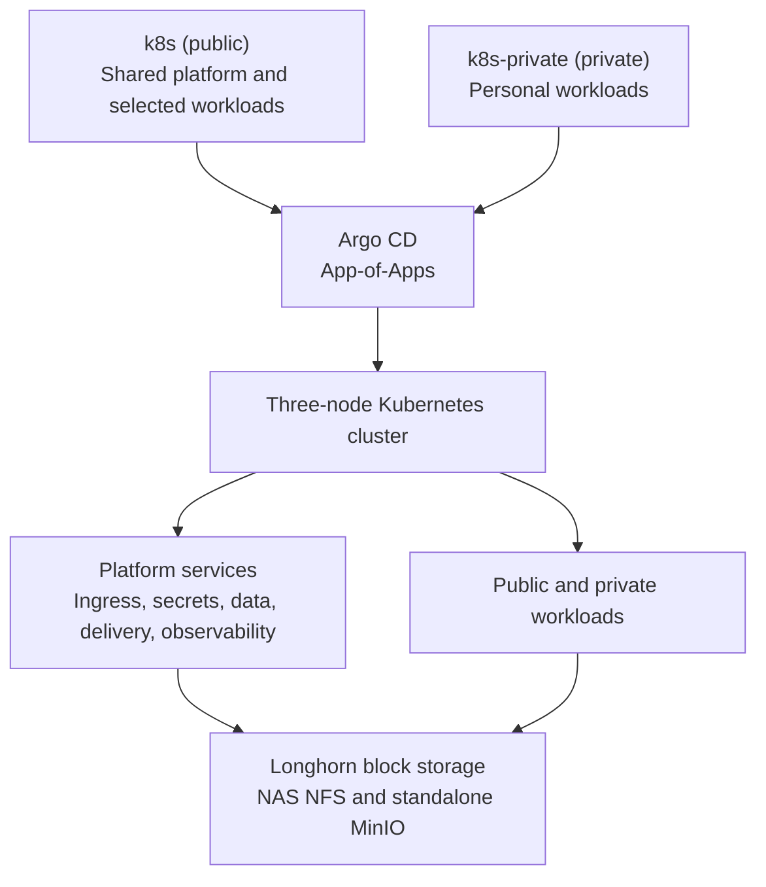

# ShivWS

ShivWS is the GitOps application layer for a three-node bare-metal Kubernetes
homelab. I use it to operate shared platform services and self-hosted
workloads, with desired state split between this public repository and a
private workload repository.

> This repository starts at the application-delivery layer. Node provisioning,
> Kubernetes bootstrap, network-appliance configuration, live secret values,
> and break-glass procedures are outside its scope.

## Current Footprint

Snapshot verified against both Git sources and the live cluster on 2026-08-06.

| Area | Current state |
|---|---|
| Compute | Three bare-metal control-plane nodes with dedicated NAS storage |
| GitOps inventory | 63 Argo CD Applications across the public and private repositories |
| Packaging | 60 Helm chart directories: 47 public and 13 private |
| Public source | Shared controllers, data services, observability, delivery tooling, and selected applications |
| Private source | 11 active personal workload Applications plus one source-only, disabled chart |

The Application count includes Argo CD roots, platform controllers, data
services, and workloads. It is not a claim of 63 user-facing services.

## Hardware

| Role | Hardware | Capacity and connectivity |
|---|---|---|
| Compute | 3x Minisforum MS-A2 | AMD Ryzen 9 9955HX, 64 GB RAM, 1 TB NVMe, and 10 GbE per node |
| Storage | UniFi UNAS Pro 8 | 56 TB usable RAID 6, 2 TB NVMe cache, and 10 GbE |
| Network edge | UniFi USW Aggregation and Cloud Gateway Fiber | 10 GbE compute/storage fabric with a dedicated routing and firewall boundary |

All compute nodes and the NAS connect through the 10 GbE aggregation switch.
The NAS is dedicated to storage and does not run Kubernetes workloads.
Latency-sensitive volumes use Longhorn-managed node storage, while bulk and
shared datasets use NFS. Hardware and network provisioning remain outside this
repository.

## Desired-State Architecture



The public [Application inventory](apps/argocd-apps/values.yaml) also creates
the private root Application. Most child Applications use automated sync,
self-healing, and pruning, including Argo CD itself. Pruning is disabled
selectively where an automatic delete would carry a larger state or
control-plane risk.

The public `argocd-apps` root enables automated sync, self-healing, and pruning
in both its [bootstrap manifest](apps/argocd-apps/application.yaml) and its
self-managed inventory entry. Removing a child Application from Git can prune
that Application. The `argocd` Application automatically reconciles
`apps/argocd` from `main`, including upgrades, drift correction, and resource
deletions, while retaining `CreateNamespace=true` and `ServerSideApply=true`.

## Platform Surface

| Area | Implementation and evidence |
|---|---|
| GitOps and delivery | [Argo CD App-of-Apps](apps/argocd-apps/), [Argo Rollouts](apps/argo-rollouts/), [canary](apps/canary-demo/), and [blue-green](apps/rollouts-demo/) examples |
| Networking | [Traefik](apps/traefik/), [MetalLB](apps/metallb/), [cert-manager](apps/cert-manager/), and [Cloudflare Tunnel](apps/cloudflared/) |
| Identity and secrets | [Vault with Raft storage](apps/vault/) and [External Secrets Operator](apps/external-secrets/) |
| Data and storage | A [three-instance CloudNativePG cluster](apps/postgresql/templates/cluster.yaml), Redis, MongoDB, Kafka, RabbitMQ, Longhorn, NAS NFS, and standalone MinIO |
| Observability | Prometheus, Grafana, Alertmanager, Loki, Tempo, Pyroscope, Alloy, Datadog integrations, and [Radar](apps/radar/) with [Caretta](apps/caretta/) network flows |
| Policy and scanning | Kyverno, Policy Reporter, and Trivy provide policy and vulnerability-reporting infrastructure; custom policy coverage is still being developed |
| CI infrastructure | Autoscaling [GitHub Actions runners](apps/github-actions-runners/), isolated [Docker runners](apps/github-actions-docker-runners/), and repository-scoped [runners for private personal repositories](apps/github-actions-personal-runners/) managed with Actions Runner Controller |

These components provide platform capabilities; their presence does not imply
that every workload has identical authentication, telemetry, policy, or
availability coverage.

## Selected Engineering Decisions

### Reconciliation with explicit failure boundaries

Application reconciliation is Git-driven, but automation is not treated as an
absolute. The [Application configuration](apps/argocd-apps/values.yaml) enables
automated sync, self-healing, and pruning for Argo CD itself, while disabling
pruning for selected stateful or control-plane components. Changes to Argo CD
on `main` reconcile without a manual sync, so controller upgrades and resource
deletions require review before merge.

### Secrets stay referenced in Git

Vault is the credential authority for most workloads. External Secrets reads
Vault references and materializes ordinary Kubernetes Secret objects for
applications. This keeps live credential values out of Git without making a
broader claim about Kubernetes Secret or etcd storage.

### Storage is selected per workload

[Longhorn](apps/longhorn/) provides block storage with a two-replica default
and an explicit one-replica class for data with a different durability/cost
tradeoff. Large shared datasets use NAS-backed NFS. [MinIO](apps/minio/) is a
single instance on NFS and is not described as a distributed object store.

[pgAdmin](apps/pgadmin4/values.yaml) uses `Recreate` updates so the old pod
releases its Longhorn ReadWriteOnce volume before the replacement starts.
Updates briefly interrupt service while preserving the existing `pgadmin4`
PVC and its SQLite configuration database; a rolling surge can otherwise
stall when the replacement is scheduled on another node.

### Kafka heap stays inside the container budget

The three combined Kafka controller/brokers use explicit
`-Xms512m -Xmx1g`, with a 1 GiB memory request and 2 GiB limit per container.
Percentage-based heap sizing in the pinned image selects host RAM rather than
the cgroup budget, producing a roughly 45 GiB maximum heap and recurring
container OOMs. The explicit maximum leaves 1 GiB for native allocations,
thread stacks, and other cgroup charges without increasing the resource limit.

Merge [Kafka values](apps/kafka/values.yaml) through the existing GitOps path
and retain the StatefulSet's rolling update. Never concurrently restart its
three quorum members. After reconciliation, confirm a 1024 MiB maximum heap,
healthy quorum and replication, stable GC, and no new OOM/restart increments
under representative traffic; TCP readiness alone does not prove quorum health.

### Trivy scan memory and report storage

[Trivy values](apps/trivy/values.yaml) keep standalone scanning, ten concurrent
jobs, slow scanning, and the existing vulnerability, secret, and SBOM coverage.
The chart's inline Trivy configuration selects `cache.backend: memory` for
process-local analysis results. Vulnerability databases remain on disk.
Sibling image-scan processes otherwise contend for one filesystem/BoltDB
analysis cache and time out on its lock.

Scanner resources also apply to vulnerability-database download init
containers: each requests 512 MiB and is limited to 1 GiB. Both DB downloads
and image scans exceeded the previous 500M limit. Process-local caching uses
memory, so confirm representative large-image scans complete within the new
bound after Argo CD reconciliation; do not infer success from operator
Deployment readiness alone. Check new reports, scan-job completion, cache-lock
errors, and OOM/retry deltas.

Kubernetes report-object size is a separate boundary. Compressed scan logs are
decoded before the operator writes structured report CRs, so transport
compression does not bypass API/etcd object limits. Large SBOMs can therefore
fail to persist even when vulnerability and secret reports succeed. Preserve
all report types and inspect each report's freshness rather than treating
partial report creation as a complete scan.

Moving to the operator's alternate report storage would replace report CRs
with PVC-backed JSON. That requires a separately reviewed durable-storage,
reader/metrics, retention, and secret-findings access-control migration; this
chart does not silently switch storage or truncate findings. The cache/memory
change does not resolve oversized report objects.

### Telemetry coverage is incremental

[Prometheus and Grafana](apps/kube-prometheus-stack/) provide metrics,
dashboards, and alerting. [Alloy](apps/alloy/) centralizes logs and exposes
receivers for traces; Tempo and Pyroscope support instrumented or annotated
workloads. The repository describes the telemetry platform, not universal
end-to-end instrumentation.

#### Redis memory alert semantics

The [Datadog Terraform root](https://github.com/Shivppatel/tf/tree/main/datadog)
adopts existing monitor `18307497` in place through a declarative import,
with destruction prevented. Its five-minute alert compares each shared Redis
container's working set with its existing 192 MiB cgroup limit, grouped by
namespace, pod, and container. Warning/critical thresholds remain 70%/90%.
The provider targets the existing US5 Datadog site; API/application credentials
remain externalized.

`redis.mem.maxmemory=0` means the dataset has no configured maximum. Dividing
by that value produces no meaningful capacity percentage even when Redis
telemetry is healthy. This change does not set a Redis dataset cap or alter
authentication, persistence, or eviction policy.

Argo CD Redis and Immich Valkey have no container memory limits, so this
percentage monitor explicitly excludes them. Existing host-memory (`18307496`),
OOM (`18307525`), and restart (`18307527`) monitors provide distinct coverage,
not equivalent per-container capacity alerts.

Review the Atlantis plan before apply: expect one import and an in-place
update of `18307497`, with no creates, deletes, or replacements. The configured
Datadog backend had no workspace rows during adoption research; confirm there
is no external IaC owner before applying. Only an approved Atlantis apply
changes the monitor. Verify four finite per-container percentages and the
existing monitor's evaluated groups after apply; a successful local query is
not deployment evidence.

#### Grafana admin credentials and persistence

Grafana at `https://grafana.shivpatel.xyz` uses the `grafana-admin`
ExternalSecret in `observability`, backed by `vault-backend`. The credential
authority is Vault KV v2 path `secret/observability/grafana`, property
`adminPassword`. Provision this property before initial deployment. The manifest's
API path is `secret/data/observability/grafana`. ESO creates Secret
`grafana-admin` with `admin-user: admin` and `admin-password`; no password
value belongs in Git.

The chart references this existing Secret instead of generating credentials.
Argo CD renders Helm offline, so the chart's `lookup` cannot reuse the live
Secret and its random-password fallback otherwise changes desired credentials
on each render. The ExternalSecret and StatefulSet use the default sync wave
`0`; the pod waits for ESO to materialize the Secret. `vault-backend` and ESO
must already be healthy. Credentials refresh hourly; a missing Vault property
retains an already materialized Secret rather than replacing it.

Grafana retains its SQLite database, including password changes made in the
UI, on the existing 20 GiB ReadWriteOnce StatefulSet claim
`storage-kube-prometheus-stack-grafana-0`, mounted at `/var/lib/grafana`.
Storage class selection remains the cluster default (currently `longhorn`);
this change does not replace the claim or change its storage class.
Keep that PVC across chart upgrades and pod replacement.

The Secret supplies **initial** admin credentials, not a continuous database
password reset. On an existing database, changing the Secret, syncing Argo CD,
or restarting the pod does not change the login password. If the database
password already differs, recover it using Grafana's supported admin-password
reset procedure, then keep the retained password in Vault. Changing a password
in Grafana also requires updating Vault if fresh-database recovery should use
the same password. Do not delete the database or PVC to repair authentication.

### CI runners are workloads, not pets

The runner charts use bounded autoscaling, non-root containers, dropped
capabilities, disabled service-account token mounting, namespace quotas, and
targeted network policies. See the
[runner values](apps/github-actions-runners/values.yaml) and
[network policy](apps/github-actions-runners/templates/network-policy.yaml).

## Change and Validation Path

```text
Pull request
  ├─ changed Helm app: helm lint + helm template
  └─ changed non-template YAML: relaxed yamllint

Merge to main
  └─ Argo CD reconciles automated Applications

Renovate
  └─ opens Helm dependency updates; non-major updates are grouped
```

The workflows are intentionally described narrowly:

- [Helm CI](.github/workflows/helm-lint.yaml) checks changed chart directories,
  not every chart on every pull request.
- [YAML CI](.github/workflows/yaml-lint.yaml) is syntax/style linting for
  changed non-template YAML, not Kubernetes schema or integration validation.
- [Renovate](renovate.json) tracks Helm dependencies, not container image tags.
- [Gitleaks](.pre-commit-config.yaml) is available as a local pre-commit check.

## Review Path

For a focused code review, start with:

1. [Application ownership and sync policy](apps/argocd-apps/values.yaml)
2. [PostgreSQL topology and managed roles](apps/postgresql/templates/cluster.yaml)
3. [Operational alert rules](apps/kube-prometheus-stack/templates/homelab-observability-rules.yaml)
4. [Self-hosted runner isolation](apps/github-actions-runners/)
5. [Progressive-delivery examples](apps/canary-demo/rollout.yaml)

## Scope and Current Priorities

This is a personal, single-site lab used to practice production-oriented
platform engineering. It is not presented as a customer production
environment or an SLA-backed service.

- Git records desired state; this README is not a point-in-time availability
  report.
- Availability, replication, authentication, and instrumentation vary by
  workload. A three-node cluster does not make every component highly
  available.
- Backup configuration, successful restore drills, and measured RPO/RTO are
  not currently versioned here, so no disaster-recovery guarantee is claimed.
- Kyverno and Policy Reporter are installed, but committed custom policy
  coverage is not yet comprehensive.

The next engineering priorities are to add repeatable recovery evidence,
version policy guardrails, narrow Argo project permissions, strengthen
dependency and raw-manifest validation, and replace remaining mutable image
references.

## Repository Layout

```text
apps/
├── argocd/                 # Argo CD configuration
├── argocd-apps/            # Public and private Application inventory
├── <platform>/             # Shared platform Helm wrappers and templates
└── <workload>/             # Selected public workload configuration

.github/workflows/          # Changed-chart and YAML validation
renovate.json               # Helm dependency update policy
```

Normal application changes should flow through Git and Argo CD. Cluster
bootstrap and documented break-glass operations are explicit exceptions.
